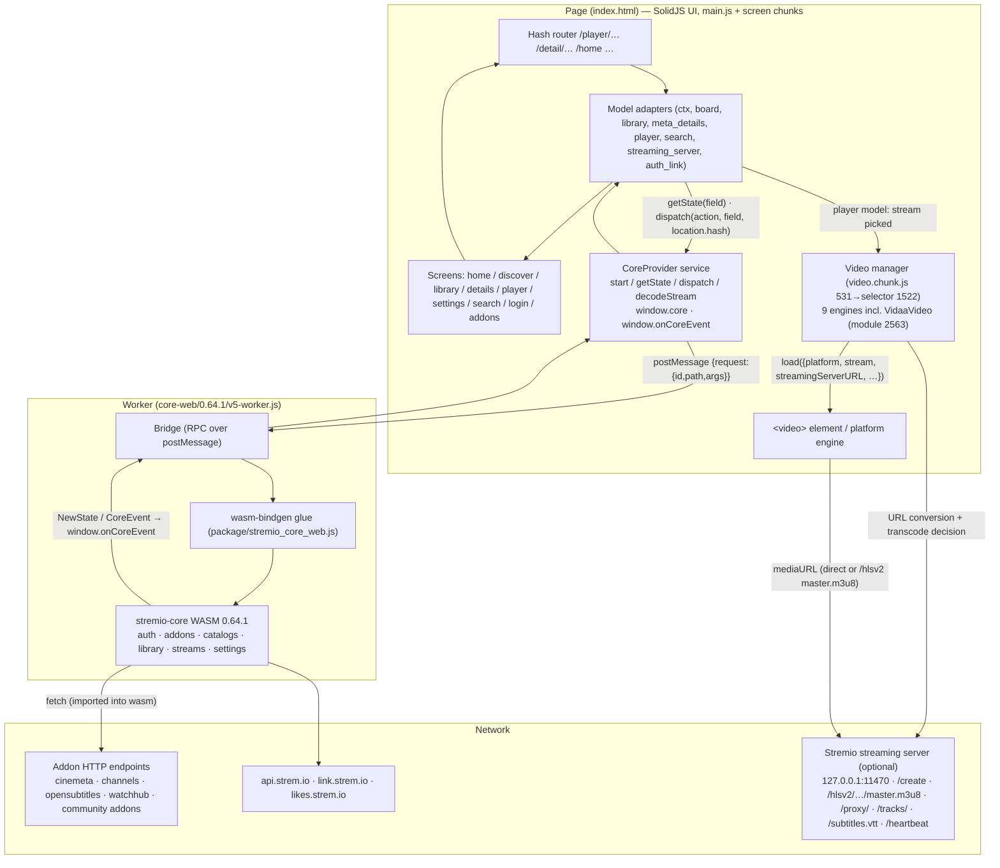

# Upstream Analysis — `theater-1.10.0` & `core-web` (0.64.1)

> **Official technical reference for patch development.**
> Scope: strictly the code inside `upstream/theater-1.10.0/` and
> `upstream/core-web/0.64.1/` as locked by `UPSTREAM.lock.json`.
>
> **Reading guide / citation conventions.** The Theater distribution is a
> compiled, minified webpack product — every claim below was extracted from the
> actual bytes of these files (grep-anchored, not inferred from general Stremio
> knowledge). Because each bundle is a single line, locations are cited as
> `file@byte-offset` (from `grep -bo`), plus the webpack module id where one is
> identifiable (`module 1522`, `module 2563`, …). Offsets and ids are valid for
> the pristine 1.10.0 re-baseline (CDN files Last-Modified 2025-12-05); they
> **will drift on the next upstream re-baseline** — re-anchor with the quoted
> code snippets, which are the durable identifiers (this is exactly what
> `patches/chunk-edits/*.json` keys on). `v5-worker.js` is readable, bundled
> esbuild output and is cited by line number.

---

## 1. Overview, Architecture & Integration

### 1.1 What each component is

**`theater-1.10.0/` — the compiled TV frontend ("Stremio Theater").**
A SolidJS single-page app shipped compiled-only from Stremio's CDN
(`wn7lso8ghdka.stremio.com/hisense/<version>/`). It is a **multi-platform TV
web app**: the same bundle runs on webOS (LG), Tizen (Samsung), TitanOS (Philips
and friends), NetTV (Panasonic and friends), plain browsers ("Web") — **and
VIDAA (Hisense)**, which is a first-class platform inside this build. It
renders the whole UI (Board/Discover/Library/Search/Details/Player/Settings/
Login/Addons), handles remote-key spatial navigation, and owns the video engine
layer that ultimately plays streams. It contains **no business logic about
catalogs, addons, library or auth** — all of that is delegated to the core
engine.

**`core-web/0.64.1/` — the stremio-core engine, compiled to WebAssembly.**
`@stremio/stremio-core-web` from npm (MIT), packaged here as two files:
`v5-worker.js` (a self-contained classic Web Worker bundling the wasm-bindgen
glue) and `stremio_core_web_bg.wasm` (4.9 MB binary). The core owns
authentication, addon negotiation (the addon protocol), catalogs, library
state, search, stream resolution, playback session state, settings and their
persistence, Trakt/metadata integrations — i.e., essentially the entire
application model. The UI is a projection of the core's state.

### 1.2 How the two components interact

The boundary is a **symmetric JSON-RPC over `postMessage`, carried by a
`Bridge` class that ships in `v5-worker.js` and is mirrored (minified) in
`main.js`**:

- Message format (both directions), `v5-worker.js:460-499`:
  ```js
  handler.postMessage({ request: { id, path, args } });
  // …handled on the other side, which replies:
  { response: { id, result: { data } | { error } } }
  ```
  `Bridge` constructor (`v5-worker.js:391-410`): resolves `request.path` by
  walking the target scope (`path.reduce((v, prop) => v[prop], scope)`), calls
  it with `args` (bound to the parent object as `thisArg`), and posts the
  result back. `Bridge.call(path, args)` returns a Promise resolved by the
  matching response id (`v5-worker.js:461-496`).

- **UI → core** (main.js core service, `main.js@~120780`):
  ```js
  load: async () => {
      const { default: r } = await n.e(9114).then(n.t.bind(n, 9861, 23));
      e = new r;                        // the Worker (chunk 9114, module 9861)
      t = new (a())(window, e);         // Bridge client: scope=window, handler=worker
  },
  start:      e => t.call(["init"], [e]),                       // e = appInfo
  getState:   e => t.call(["getState"], [e]),
  dispatch:  (e, n) => t.call(["dispatch"], [e, n, location.hash]),
  decodeStream: e => t.call(["decodeStream"], [e]),
  stop:     () => { e && e.terminate() }
  ```
  On the worker side, `path ["dispatch"]` resolves against the worker's `self`,
  where the entry module assigned the wasm wrappers (`v5-worker.js:1423-1427`:
  `self.getState = get_state; … self.dispatch = dispatch; self.analytics =
  analytics; self.decodeStream = decode_stream; self.encodeStream = encode_stream`).

- **core → UI (events)**: the core, once initialized with
  `initialize_runtime(emit_to_ui)`, pushes state through
  `v5-worker.js:1431-1433`:
  ```js
  await initialize_runtime(function(event) {
      return bridge.call(["onCoreEvent"], [event]);
  });
  ```
  which executes `window.onCoreEvent(event)` **on the page** — main.js assigns
  exactly that global (`main.js@~120600`: `window.core = t, window.onCoreEvent
  = v`) and fans the event out:
  ```js
  v = ({ name, args }) => {
      switch (name) {
          case "NewState":  u().forEach(e => e(args)); break;      // model subscribers
          case "CoreEvent": if ("Error" === args.event) { /* source, error.message → error handlers */ }
      }
  };
  ```

- **core → page (host services)**: the engine has no DOM, so it calls back
  into the page through the same bridge for host services —
  `v5-worker.js:1372-1419`:
  ```js
  self.get_location_hash        = () => bridge.call(["location", "hash"], []);
  self.local_storage_get_item   = (key)       => bridge.call(["localStorage", "getItem"], [key]);
  self.local_storage_set_item   = (key, value)=> bridge.call(["localStorage", "setItem"], [key, value]);
  self.local_storage_remove_item= (key)       => bridge.call(["localStorage", "removeItem"], [key]);
  ```
  **The core's persistence and location live in the page's localStorage /
  URL hash.** This is why settings survive per-browser, and why the app's
  `location.hash` (the router state) is visible to the core (it is passed as
  the third `dispatch` argument too).

- **Bootstrap handshake**: main.js `CoreProvider` on mount
  (`main.js@~120620`):
  ```js
  if (!window.core) try {
      await t.load();
      await t.start(e.appInfo);        // appInfo = { appVersion:"1.10.0", shellVersion:null }
      window.core = t; window.onCoreEvent = v;
  } catch (e) { console.error("Failed to initialize core:", e); … }
  ```
  The worker's `self.init({appVersion, shellVersion})` (`v5-worker.js:1346-1352`)
  also **shims `self.document = { baseURI: self.location.href }`** so the
  wasm-bindgen glue (which references `document.baseURI` at
  `v5-worker.js:522-524`) works inside a worker, then loads the WASM:
  `initialize_api(require_stremio_core_web_bg())` where the wasm-url module
  resolves to the relative string `"stremio_core_web_bg.wasm"`
  (`v5-worker.js:1346-1350`, `1355-1360`) — i.e. **the binary is fetched next
  to the worker file itself**.

> **Repo note (not upstream behavior):** pristine Theater 1.10.0 lazily loads
> **webpack chunk `9114` ("core", see `runtime.js` chunk map)** whose module
> `9861` is a worker *factory* that builds the engine worker from an inline
> blob (module `6620` is the blob-worker-loader polyfill). In this repository,
> chunk 9114 is replaced wholesale by `patches/custom/core.chunk.js`, whose
> factory simply does `new Worker('v5-worker.js')` — pointing at
> `core-web/0.64.1/v5-worker.js` copied verbatim into the site root. That is
> the graft point between the two upstream components. (Upstream's own inline
> worker targets the older v4 engine protocol; the fork lineage discovered the
> v5 worker speaks the same `init/getState/dispatch/…` paths, which is why the
> swap works.)

### 1.3 Architectural pattern of each side

| Aspect | `theater-1.10.0` | `core-web` |
|---|---|---|
| Pattern | SolidJS SPA, hash router, spatial-navigation UI, plugin-style **video engine registry** | Monolithic **actor in a Worker**: wasm state machine + event emitter, "model" views over one state tree |
| State | Signals/stores fed by `getState(field)` pulls + `NewState` event pushes (`main.js` model registry, `model:"ctx" \| "board" \| "continue_watching_preview" \| "discover" \| "library" \| "meta_details" \| "player" \| "search" \| "streaming_server" \| "auth_link"`) | Single Rust core; `get_state(field)` returns a serialized JSON projection; `dispatch(action, field, location_hash)` mutates |
| Concurrency | UI thread; engine chunk loaded on demand (`n.e(6180)`) | Dedicated Worker; wasm-bindgen externref table for JS values; timers inside wasm |
| Persistence | Page `localStorage` only for UI conveniences (focus memory `"home"/"discover"/"library"/"search"` stores, `warningModalDismissed`) | **Through the bridge into the page's `localStorage`** (auth key, settings, library cache) |
| Styling | CSS modules compiled to static class strings (`a.locals={…}`, seen throughout main.js/chunks) | n/a |

### 1.4 High-level data flow



Key non-obvious facts the diagram encodes:

1. **All addon/API HTTP traffic is issued from inside the Worker** (the wasm
   imports `fetch` — `v5-worker.js:608-611` `__wbg_fetch_c6f0d65561ded911`). The
   page itself only fetches the streaming server (engine layer) and the auth QR
   assets.
2. The **player UI never plays video directly** — it dispatches into the video
   manager, which picks an engine by platform; playback itself is `<video>` or
   a platform media object.
3. The **streaming server is optional**: without `streamingServerURL` the
   selector still resolves an engine, but only direct-URL streams can load
   (`module 1522` requires `"string" == typeof e.stream.url` on that path).

---

## 2. Feature Mapping

### 2.1 `theater-1.10.0` — features delivered

**Shell & navigation**
- Hash-based router; route table (`main.js@~119500`):
  `/home`, `/discover`, `/discover/:type`, `/discover/:transportUrl/:type/:id`,
  `/library/:type?`, `/addons`, `/settings`, `/detail/:type/:metaId/:videoId?`,
  `/player/:stream`, and a long player form
  `/player/:stream/:streamTransportUrl/:metaTransportUrl/:type/:id/:videoId?`
  (both player routes carry `data:{hideNavbar:!0}`). Components are
  lazy-loaded from their named chunks; every route has an auth `guard`.
- Two-level nav rail: main (`STREMIO_TV_NAV_HOME/DISCOVER/LIBRARY/ADDONS/
  SETTINGS` + a `MORE` overflow) and a discover sub-nav
  (`/discover/movie|series|channel`, each with `isFocused` matching the
  catalog `type`) — `main.js@~119300`.
- **Spatial navigation for remotes** (`main.js@439300-441200`): focusables
  registered with `nav-id`; areas declare `nav-area`; scroll containers
  declare `nav-axis` / `nav-scroll-anchor`; a `MutationObserver` on `#root`
  watches `nav-id` attribute changes; focus transitions set the `focused`
  attribute and emit `enter/leave/focus/blur` per area. Input sources: real
  `keydown`, mouse `wheel`, and **gamepads** — a 100 ms poll maps
  axes/buttons to synthetic `KeyboardEvent`s for `up/down/left/right/ok/back`
  (`main.js@439350`).
- **Remote key bus**: one normalized keydown handler maps keys to semantic
  names and broadcasts them — consumers subscribe via
  `keybus().on(name, handler)`; names observed in the player screen include
  `play, pause, playPause, stop, left, right, ok, any, back, seekPrev,
  seekNext` (`main.js@~439900`, `player.chunk.js@39500`). Media keys are
  `preventDefault`-ed at source.
- Splash/loading and fatal-error screens (the fatal screen runs
  `await localStorage.clear(), location.reload()` — `main.js@~96000`).

**Platform abstraction (module 2497, `main.js@87900-88300`)** — the TV
multi-platform layer:
- Detection (runs once at module load):
  ```js
  // webOS: exact-UA lookup table (Chrome 120→25 … QtWebEngine 5.2.1→3)
  const i = () => ({ "Mozilla/5.0 (Web0S; Linux/SmartTV) … Chrome/120.0.6099.270 …": 25, /* 8 entries */ }[navigator.userAgent] || 0);
  const a = () => navigator.userAgent.match(/Tizen (\d+\.\d+)/i);        // → parseFloat
  const l = () => navigator.userAgent.match(/TitanOS\/(\d+\.\d+)/i);
  const s = () => navigator.userAgent.match(/NETTV\/(\d+\.\d+.\d+.\d+)/i);
  const c = () => { try { const e = Hisense_GetOSVersion();               // ← VIDAA
                         return parseFloat(e.replace(/[^\d.]/g, "")) } catch (e) { return 0 } };
  // precedence: webOS-UA → Tizen → NetTV(before Titan) → Titan → VIDAA; else "Web"
  ```
- Result exposed through a Solid context: `{ name, version, quit, openExternal,
  showAlert, isTizen, isWebOS, isTitan, isNetTV, isWeb, isVidaa }` with:
  - `quit()`: tizen `application.getCurrentApplication().exit()` / webOS
    `platformBack()` / Titan `SmartTvA_API.exit()` / **else `window.close()`**
    (VIDAA lands here);
  - `openExternal({url, payload})`: Tizen `ApplicationControl` (operation
    `view`, `PAYLOAD` from `tizenUrl`), webOS Luna
    `com.webos.applicationManager/launch` (browser app fallback with a
    friendly "X is not installed" toast), **else `window.open(url,"_blank")`**;
  - `showAlert`: Tizen `alert()` / webOS Luna `com.webos.notification/
    createToast` (`sourceId:"io.strem.tv"`).
- Tizen-only: registers extra remote keys at mount — `registerKeyBatch
  (["MediaPlayPause","MediaPlay","MediaPause","MediaStop","MediaRewind",
  "MediaFastForward","MediaTrackNext","MediaTrackPrevious","0"…"9"])`.

**Video engine layer (`video.chunk.js`, chunk id 6180 — 576 KB)** — see §4.3
for the full flow. Feature-wise it delivers:
- **Nine engine adapters**, each a self-contained module exposing a
  `manifest = { name, external, props, commands:["load","unload","destroy"],
  events:["propValue","propChanged","ended","error","subtitlesTrackLoaded",
  ("audioTrackLoaded")] }`, an event emitter surface, and a static
  `canPlayStream(stream, context) → Promise<boolean>`:

  | Engine | Module (re-export chain) | Backing technology | Notes |
  |---|---|---|---|
  | `VidaaVideo` | **2563** (as 7575) | plain `<video>` element | accepts **every** stream (see §2.4) |
  | `HTMLVideo` | 4625 (as 4333) — the `else`/"Web" default | `<video>` + HTML-rendered subtitles (CSS-rule styling, error tags `"HTMLVideo"`/`"VVideo with HTML Subtitles"`) | its `canPlayStream` refuses `behaviorHints.notWebReady` (verbatim: `d.canPlayStream=function(e){return!e||e.behaviorHints&&e.behaviorHints.notWebReady?Promise.resolve(!1):u(e)}` — chunk-edit anchored) |
  | `TizenVideo` | 1621 (as 8968) | Samsung AVPlay (`application/avplayer` object, `window.webapis.avplay`) | incl. `\an8`-aware SRT rendering |
  | `WebOsVideo` | 6191 | webOS media pipeline | — |
  | `TitanVideo` | 5166 | Titan media object | — |
  | `ShellVideo` | 2366 | **mpv** over `shellTransport` (`"mpv-command"`, `"mpv-observe-prop"` — module 7241) | desktop-shell builds |
  | `IFrameVideo` | 7838 | embedded iframe (`playerFrameUrl` streams) | `external: true` |
  | `YouTubeVideo` | 1031 | YouTube embed (`stream.ytId`) | — |
  | `ChromecastSenderVideo` | 7705 | Cast framework | `external: true`; chosen when `castState === CONNECTED` |
- **Engine selection** (module 1522, verbatim imports
  `var n=r(1410),i=r(2366),a=r(4333),s=r(8968),o=r(5166),l=r(7575),u=r(6191),
  c=r(7838),d=r(1031),h=r(902),f=r(7495),g=r(4812)`):
  ```js
  e.stream && "string" != typeof e.stream.externalUrl
    ? chromecastConnected                        ? ChromecastSender          // n
    : typeof e.stream.ytId        === "string"   ? YouTube                   // g(f(d))
    : typeof e.stream.playerFrameUrl === "string"? IFrame                    // g(c)
    : t.shellTransport                           ? Shell                     // h(f(i))
    : typeof e.streamingServerURL === "string"
        ? "Tizen"===platform ? h(f(s))   // 8968→1621 TizenVideo
        : "webOS"===platform ? h(f(u))   // 6191 WebOsVideo
        : "Titan"===platform||"NetTV"===platform ? h(f(o))  // 5166 TitanVideo
        : "Vidaa"===platform ? h(f(l))   // 7575→2563 VidaaVideo
        : h(f(a))                          // 4333→4625 HTMLVideo
    : typeof e.stream.url === "string" ? /* same platform map, g() instead of h() */
    : null
  ```
  i.e. **platform decides the engine class**; on VIDAA every non-special stream
  is handled by `VidaaVideo`.
- **Streaming-server integration** (the `h()` wrapper, module 3657
  `video.chunk.js@452878`, with helpers 7037/5872/6089/2152):
  - infoHash streams → `POST <server>/<infoHash>/create` with
    `{torrent:{infoHash}, peerSearch:{sources:["dht:<hash>",…"tracker:…"],
    min:40,max:200}, guessFileIdx:{season,episode}}`, then media URL
    `<server>/<infoHash>/<fileIdx>?tr=…` (module 5872);
  - magnet: URLs decoded client-side (module 3909) into the same path;
  - proxied streams → `<server>/proxy/?d=<origin>&h=<reqHdr k:v>&r=<respHdr
    k:v><path>` when `proxyStreamsEnabled` or `behaviorHints.proxyHeaders`
    (module 7037);
  - **playability probe**: `engine.canPlayStream({url}, {formats, videoCodecs,
    audioCodecs, maxAudioChannels})` (defaults from module 5399); on `false`
    (or `forceTranscoding`), playback goes through the server:
    `<server>/hlsv2/<profile>/master.m3u8?mediaURL=…&videoCodecs=…&
    audioCodecs=…&maxAudioChannels=…[&forceTranscoding=1]` with every
    subtitle track rewritten to `<server>/subtitles.vtt?…` for burn-in;
  - **VERIFIED server URL surface (2026-10-08, stremio-video cross-check)**:
    the official client builds the master.m3u8 URL with EXACTLY
    `mediaURL`, `forceTranscoding`, `videoCodecs` (multi-value),
    `audioCodecs` (multi-value) and `maxAudioChannels` — confirmed against
    both the Theater engine (module 3657) and the open-source
    `Stremio/stremio-video` `withStreamingServer.js` (near-identical code).
    **There is NO audio-track-selection parameter** (`audioStream` etc.) —
    stremio-server is closed-source (no public repo), no Stremio-org client
    sends one, and stremio-video's own comment states the limitation:
    *"HTML5 video doesn't support multiple audio tracks, so we can't switch
    languages"*. `/tracks/` returns a flat array of track objects
    (`{type:'audio'|'text', codec, channels, lang, …}` — filter client-side,
    module 2152); the listing is real but selection-wise the params above
    are the complete surface. Multi-audio on a TV browser today = the
    native-player handoff (Yellow key), not a server param;
  - OpenSubtitles hash via `<server>/opensubHash?videoUrl=…` when
    `behaviorHints.videoHash/videoSize` are absent (module 6089);
  - audio/subtitle track *listing* for the current media from
    `GET http://127.0.0.1:11470/tracks/<encoded mediaURL>` (module 2152 —
    hardcoded host upstream).
- **DOM subtitle renderer** (module 6373): the wrapper that gives engines
  `extraSubtitles*` props — renders WebVTT cues (module 3133 → 1417) into an
  absolutely-positioned bottom overlay with size/offset/colors/opacity/delay
  applied in CSS.
- **Engine swap manager** (module 531, exposed to the player screen as module
  9794→2715→531): on every `command:load` it re-runs the selector, destroys the
  previous implementation if the class changed, re-wires events, and raises
  `UNSUPPORTED_STREAM {critical:true}` when no engine matches.

**Player screen (`player.chunk.js`, chunk 1088 / screen module 7488)**
- Lazy engine instantiation: `t.e(6180).then(t.t.bind(t, 9794, 23))` —
  `player.chunk.js@19797`; dispatch protocol `{type:"command", commandName:
  "load"|"unload"|"addExtraSubtitlesTracks", commandArgs}`, `{type:"setProp",
  propName, propValue}`, `{type:"observeProp", propName}`.
- Overlays/menus: subtitles picker (language, delay stepper, size, vertical
  offset, opacity, text/outline/background colors), audio-track picker,
  playback speed (0.25×…2×), episode switcher; a stepper overlay with ±
  controls; seekbar with buffered/played bars, **intro/outro skip markers**
  (from `player.introOutro`), click-to-seek with a `window.screen720p` 1.538×
  compensation factor, and accelerating key seeks (step = settings
  `seekTimeDuration`, ×1.1 per repeat, capped at 50 s).
- Autoplay next episode: popup when `bingeWatching()` and remaining ≤
  `nextVideoNotificationDuration`, with dismiss; skip-intro/outro popups.
- Progress reporting back into the core: `player.updateVideoParams`,
  `updateSeek`, `updateTime` (throttled 1 s), `updatePaused`; resume position
  seeded from the library item's `state.timeOffset`.
- Error policy: only **critical** engine errors take the full-screen warning;
  non-critical ones become toasts (`player.chunk.js@39060/40925`).

**Other screens** (verified per chunk):
- **home** (`home.chunk.js`): rows = `[ContinueWatching?, ...board.catalogs()]`;
  500 ms-debounced lazy catalog loading keyed on focused row; per-page focus
  memory in a localStorage-backed store; **first-run platform warning modal**
  on Titan/NetTV/**Vidaa** (see §2.4).
- **discover**: type/catalog/extra dropdowns whose every change is pure
  navigation through the core-provided `deepLinks.discover` URLs; infinite
  scroll via `loadNextPage()`.
- **library**: types & sorts entirely driven by the core model's `selectable()`
  (`TYPE_*`, `SORT_*` translation keys); empty-state CTA to Discover.
- **details**: hero (background/logo/name/description/release date localized
  by `settings.interfaceLanguage`), season dropdown + >50-episode range
  paginator with auto-follow of `lastWatchedVideoId`, per-episode watched
  toggle, spoiler blur, like/love rating widget (`setRating("liked"|"loved")`),
  **streams list grouped per addon** with platform-filtered external deeplinks
  (see §2.4), and the shared item menu (Play now, Details, Add/Remove library,
  Mark watched/unwatched, Trailer, Resume-dismiss via `rewindLibraryItem`).
- **settings**: sections Account (logout), Interface (language, animations,
  background blur, hide-spoilers), Playback → Subtitles (default +
  secondary language, size, vertical offset, opacity, 3 color pickers), Audio
  languages, seek duration, autoplay-next-episode (+popup duration), **Server**
  (online/offline row + reload, streaming-server URL row + EDIT_URL dialog,
  version row), About (version `Theater v1.10.0`, platform, Clear Data —
  disabled in production, TOS, Privacy, **QUIT** → `window.dispatchEvent(new
  Event("quit"))`). Notable negatives (verified): no hwTranscoding /
  audio-passthrough / cache-size rows, no URL validation in EDIT_URL.
- **addons**: a single "Sync addons" button calling `ctx.syncAddons()` + toast
  — no on-device addon browser/installer.
- **search**: query as route param; per-row catalogs; last-7 history from
  `ctx.searchHistory()` with clear.
- **login**: **QR-only** auth — `authLink.load()`, poll `readData` every 3 s,
  5-minute countdown, regenerate = `location.reload()`, back key = platform
  `quit()`.

**Companion-service launcher (`service.js`, chunk 652 — not a service
worker!)**
- On `DOMContentLoaded` (module 461, `service.js@~1600`): Tizen → launch native
  `IkWsFHtOY9.StremioService` via `ApplicationControl(operation/pick)`; webOS
  → Luna `luna://io.strem.tv.server/` `start`. On VIDAA **neither branch
  runs**.
- Heartbeat loop (`service.js`, original string preserved as the chunk-edit
  anchor): while not in the player, `GET http://127.0.0.1:11470/heartbeat`
  every 5 s; while `#/player/…` every 10 s idle; on `"Failed to fetch"` it
  logs `"service heartbeat - failed, restarting"` and **re-invokes the
  launcher forever** (vanilla behavior — the repo's chunk-edit caps this).

**webOSTV.js (chunk 6467)**: LG's TVJS library bundle, defining
`window.webOS` (module markers `libVersion`, version strings 1.2.11/3.47.0).
Loaded unconditionally as a deferred script; consumed by main.js (Luna toast,
service start) and video.chunk.js (WebOsVideo). Harmless no-op state on
VIDAA.

### 2.2 `core-web` 0.64.1 — capabilities delivered

The worker exposes exactly seven operations (the RPC surface the UI may
`call([...])`), `v5-worker.js:502-556` + `1423-1427`:

| Path (as called) | wasm export | Semantics |
|---|---|---|
| `["init"]` | `initialize_runtime(emit_to_ui)` (via `self.init`) | boots the runtime; wires event push |
| `["getState"]` | `get_state(field)` | serialize the named model projection (`ctx`, `board`, `player`, …); returns externref value |
| `["getDebugState"]` | — | **dead path in 0.64.1**: the worker entry destructures `get_debug_state` (`v5-worker.js:1421-1427`) but the glue module's exports (`v5-worker.js:510-524`) do not include it — it resolves to `undefined`. Do not build patches on it. |
| `["dispatch"]` | `dispatch(action, field, location_hash)` | fold an action into the state machine; **throws on error** (`if (ret[1]) throw takeFromExternrefTable0(ret[0])`) |
| `["decodeStream"]` | `decode_stream(stream)` | parse/normalize a stream descriptor (used for deep links / player route handoff) |
| `["encodeStream"]` | `encode_stream(stream)` | inverse serialization |
| `["analytics"]` | `analytics(event, location_hash)` | feed an analytics event with current route |

Feature domains visible in the binary (string table of
`stremio_core_web_bg.wasm`) and corroborated by the UI models:
- **Auth & account**: `AuthKey`, `AuthRequest`, `link.strem.io` (QR/link
  auth), `api.strem.io` (+ `/data-export/`), user sync.
- **Addon engine**: default addons pinned in-binary —
  `https://v3-cinemeta.strem.io/manifest.json`,
  `https://v3-channels.strem.io/manifest.json`,
  `https://opensubtitles-v3.strem.io/manifest.json`,
  `https://watchhub.strem.io/manifest.json`, plus
  `https://www.strem.io/trakt/addon/` and `cinemeta-catalogs.strem.io`.
- **Models** (field selectors in the wasm string table): `ActionCtx`,
  `ActionCatalogWithFilters`, `ActionCatalogsWithExtra`,
  `ActionLibraryByType`, `ActionLibraryWithFilters`, `ActionMetaDetails`,
  `ActionPlayer`, `ActionSearch`, `ActionStreamingServer`, `ActionLink`,
  `ActionLiveTvGuide`, `ActionLiveTvContinueWatching` (the UI's `board`
  model rides on the catalog actions).
- **Playback session state machine**: events/verbs such as
  `StreamStateChanged`, `VideoParamsChanged`, `SubtitlesChanged`,
  `SeekTimeChanged`, `MarkVideoAsWatched`, `MarkSeasonAsWatched`,
  `VideoEnded`, `PlayerSuccess`, `TraktPlayingH/TraktPaused/TraktLoggedOut`,
  `LibraryItemState`, `LibraryItemNotifications`.
- **Settings model** (persisted through the localStorage bridge): fields
  incl. `seekTimeDuration`, `audioPassthrough`, `subtitlesAutoSelect`,
  `subtitlesLanguage(s)`, `interfaceLanguage`, `streamingServerUrl`,
  `bingeWatching`, `nextVideoNotificationDuration`, `hideSpoilers`,
  `escExitFullscreen`.
- **Streaming-server client**: availability check, version, reload, settings
  (the `streaming_server` model consumed by the Settings screen).
- **Networking from wasm**: `fetch` imported into the module
  (`__wbg_fetch_c6f0d65561ded911`, `v5-worker.js:608-611`) — addon/catalog/
  API traffic originates in the Worker; plus `console.error`, crypto
  random, TextEncoder/TextDecoder, and the localStorage/location bridges.

### 2.3 How features are exposed

- **To users**: purely through the TV UI described in §2.1 (D-pad + keyboard
  + gamepad). There is **no CLI, no REST surface, and no background jobs** in
  either component beyond the Worker engine itself. The page's URL hash is the
  only external API: deep links (`/player/:stream/…`, `/discover/…`) are
  routable, and the core receives `location.hash` with every dispatch.
- **To other systems**: the streaming server contract (§2.1 video layer —
  `/create`, `/hlsv2/…/master.m3u8`, `/proxy/`, `/tracks/`, `/subtitles.vtt`,
  `/opensubHash`, `/heartbeat`) is the only outbound integration the Theater
  bundle speaks on its own (from the page, hardcoded to `127.0.0.1:11470`
  upstream).
- **Between the two components**: the `Bridge` RPC + the `window.core` /
  `window.onCoreEvent` globals (see §1.2) — which double as the primary
  extension seam for this repository (§5).

### 2.4 VIDAA-specific behavior already present upstream (do not re-patch)

This build **is** Stremio's Hisense/VIDAA distribution — VIDAA support exists
upstream. The complete inventory:

1. **Platform detection** — VIDAA is identified by the global
   `Hisense_GetOSVersion()` (parsed to a float) with a try/catch fallback to
   `Web`; priority puts it after webOS/Tizen/NetTV/Titan UA checks (module
   2497, quoted in §2.1). Flag exposed as `isVidaa` / `name:"Vidaa"`.
2. **`VidaaVideo` engine (module 2563, `video.chunk.js@443378-450900`)** — a
   plain HTML5 `<video>` adapter:
   - `canPlayStream = function(e) { return e ? Promise.resolve(!0) :
     Promise.resolve(!1) }` — **accepts any non-null stream**; codec failures
     only surface later as `MEDIA_ERR_*` critical errors (mapped from
     `video.error.code` 1–4 → `HTML_VIDEO.MEDIA_ERR_ABORTED / NETWORK /
     DECODE / SRC_NOT_SUPPORTED`);
   - props limited to `stream, loaded, paused, time, duration, buffering,
     audioTracks, selectedAudioTrackId, subtitlesTracks,
     selectedSubtitlesTrackId, volume, muted, playbackSpeed` — **no
     `extraSubtitles*` support** (no DOM renderer wrap on the Vidaa path? no —
     the renderer wrapper 6373 is applied by the selector, but the engine
     itself only signals embedded `textTracks` with `EMBEDDED_<i>` ids);
   - buffering = `readyState < HAVE_FUTURE_DATA`; time/duration in integer ms;
     volume 0–100 mapped to 0–1; a show-then-disable pass over added
     `textTracks` (a quirk workaround), `audioTracks[].enabled` selection.
3. **Engine routing** — both the server-assisted and direct-URL paths route
   `"Vidaa"===e.platform` to the Vidaa engine (module 1522; `h(f(l))` /
   `g(f(l))` where `l = r(7575) → r(2563)`).
4. **First-run warning modal** (`home.chunk.js@1649`): shown once on
   `isTitan || isNetTV || isVidaa` unless `localStorage.warningModalDismissed`
   — *"Due to operating system restrictions, some Stremio features and
   streams are currently unavailable on this device."* + `I understand`.
5. **External deeplink streams** (`details.chunk.js`):
   - the streams list **keeps** `externalUrl` streams for
     `isWeb || isVidaa || isTitan || isNetTV` (Tizen/webOS require
     `tizenUrl`/`webosUrl` respectively) — `details.chunk.js@15327`;
   - but pressing one on Titan/NetTV/**Vidaa** opens a dead-end dialog:
     *"Opening other apps is not currently possible because this device does
     not support deep linking yet."* (`details.chunk.js@13410`) — upstream
     ships no VIDAA deep-link integration.
6. **quit / openExternal / showAlert** — VIDAA inherits the generic branches:
   `window.close()`, `window.open(url,"_blank")`, and no-op alert
   (module 2497). No `Hisense_*` API usage exists in the Theater bundle.
7. **Companion service** — `service.js`'s launcher skips VIDAA entirely
   (no tizen/webOS globals), yet the heartbeat keeps polling
   `127.0.0.1:11470` and retrying forever (see §2.1) — a known vanilla
   pathology on TVs without the desktop service.
8. **Login back-key** quits via the platform object (→ `window.close()` on
   VIDAA) (`login.chunk.js@1048`).

**Implication for patches**: upstream already owns detection, engine routing
and the VIDAA UI gating. Our patch layer's job is *augmentation*, not
addition: native player handoff (`Hisense_*`/`omi_platform`), exit handling,
server-URL plumbing, codec honesty (VidaaVideo's accept-everything probe),
keyboard events, etc. Anything that re-implements items 1–8 above is
redundant.

---

## 3. Module & Folder Structure

### 3.1 `core-web/0.64.1/`

| File | Role | Category |
|---|---|---|
| `v5-worker.js` (1463 lines) | esbuild-bundled classic Worker: babel helpers (lines 1-380), `Bridge` RPC class (`//` module at 380-500), wasm-bindgen glue `package/stremio_core_web.js` (502-1330: imports 546-700+, exports at 513-524, `__wbg_init`/fetch-instantiate at ~1300-1345), `wasm-url:./stremio_core_web_bg.wasm` (1346-1360), entry `package/worker.js` (1362-1455) | **Core** |
| `stremio_core_web_bg.wasm` | the entire stremio-core state machine (Rust → wasm32), incl. default addon URLs, action/model names, settings fields | **Core** |

There is no presentation or utility layer here beyond the RPC glue — the
worker is intentionally minimal.

### 3.2 `theater-1.10.0/`

Runtime loading order (as fixed by the page's deferred scripts): `runtime.js`
→ `main.js` → `service.js` → `webOSTV.js`; named chunks load on route demand.

**Presentation layer (screens & UI)**
- `home.chunk.js` (chunk 7962), `discover.chunk.js` (8842), `library.chunk.js`
  (7920), `addons.chunk.js` (5710), `login.chunk.js` (6966), `search.chunk.js`
  (187), `settings.chunk.js` (6472), `details.chunk.js` (6415),
  `player.chunk.js` (1088 — the player *screen*; engine chunk loaded lazily
  from it).
- Static assets: `logo.png`, `icon.png`, `empty.png`, `checker.svg`,
  `PlusJakartaSans.ttf`.

**Core/business logic of the frontend**
- `main.js` (444 KB) — everything non-screen: bootstrap & providers, router,
  model adapters + core service, platform module (2497), spatial navigation +
  key bus, i18n, shared components (catalog row, meta preview, item menu,
  settings list, dialogs, inputs, toast).
- `video.chunk.js` (576 KB, chunk 6180) — the video subsystem (see §2.1/§4.3);
  the de-facto most complex artifact in the distribution.
- `service.js` (chunk 652) — companion-service launcher + heartbeat.
- `webOSTV.js` (chunk 6467) — LG TVJS library defining `window.webOS`.

**Infrastructure/utilities**
- `runtime.js` — webpack 5 runtime: chunk-id→name map
  (`{187:"search",1088:"player",5710:"addons",6180:"video",6415:"details",
  6472:"settings",6966:"login",7920:"library",7962:"home",8842:"discover",
  9114:"core"}` + 50 `translationsNN` chunks), auto-publicPath from the last
  executed `<script src>` (`… .replace(/\/[^\/]+$/,"/"), i.p=t`),
  `webpackChunkstremio_theater` push-array chunk loading.
- Inside `main.js`: core-js polyfills, `mitt`-style emitter (module 5852
  referenced everywhere), color parsing, CSS modules, the translation
  `require.context` (module 9047: `"./<locale>.json": [moduleId, chunkId]`).

---

## 4. Entry Points & Primary Execution Flows

### 4.1 App bootstrap (`main.js`)

1. Script loads (deferred); webpack runtime computes `publicPath` from its own
   `src` (`runtime.js`, auto-publicPath IIFE).
2. Mount (`main.js@~120300`):
   ```js
   const U = { appVersion: "1.10.0", shellVersion: null };
   const Y = document.getElementById("root");
   (0,o.XX)( () => (0,r.a0)(l.i9, { children:
       (0,r.a0)(s.D, { defaultLocale: "en-US", children:       // i18n provider
       (0,r.a0)(i.X, { appInfo: U, loading:…, error:…, children:// CoreProvider
       (0,r.a0)(a.tv, { …, children: … } }                     // app/router + toasts
   }) }), Y);
   ```
3. **CoreProvider mount** (`main.js@~120620`): `load()` → chunk 9114 → worker
   → `start(appInfo)` → worker `self.init` shims `document`, loads WASM
   (`initialize_api("stremio_core_web_bg.wasm")`), runs
   `initialize_runtime(event → bridge.call(["onCoreEvent"],[event]))`, and
   assigns `window.core` / `window.onCoreEvent`.
4. Model registry pulls initial state: for each of the ten models
   (`model:"ctx" | "board" | …`, `main.js@~119800`) a Solid store subscribes
   to `NewState` and pulls `getState(model)` when loaded.
5. Authed boot sequence (`main.js@~119700`):
   `n.isAuthenticated() && (await n.syncUser(), await n.syncAddons(), …)`;
   unauthed users are routed to `/login` by route guards.
6. i18n: locale signal ← `settings.interfaceLanguage`; chunks fetched through
   module 9047's map; `t(key, fallback)` returns `a()[key] ?? fallback`.

### 4.2 Navigation & keys flow

`keydown` → normalized name → key bus → screen handlers (player binds
`play/pause/playPause/stop/left/right/ok/any`; screens bind `back` via
`onBack`) → spatial focus engine moves `focused`/`nav-id` state → route
changes write `location.hash` → **the hash also reaches the core** (every
`dispatch` passes `location.hash`; the core can independently read it via the
`location.hash` bridge).

### 4.3 Playback flow (the primary cross-component flow)

```
Details screen "Play" ──▶ navigate deepLinks.player ──▶ /player/:stream/… route
player.chunk.js mount:
  1. player model load(route params)              [core resolves stream]
  2. t.e(6180) → module 9794 → Video manager (531)
  3. dispatch {type:"command", commandName:"load", commandArgs:
       { platform: <platform.name>, stream, autoplay: true,
         time: libraryItem.state.timeOffset,        // resume
         forceTranscoding: false, maxAudioChannels: null,
         streamingServerURL: <settings>, seriesInfo }}
  4. module 531: platform set (5227) → selector 1522 picks engine class
  5. wrapper 3657 (server path): 7037 converts stream → {url, infoHash, fileIdx}
       engine.canPlayStream({url}, {formats,codecs,channels})
         true  → load engine with direct url
         false → <server>/hlsv2/<profile>/master.m3u8?mediaURL=… (+subtitles → /subtitles.vtt)
  6. engine (VidaaVideo on VIDAA) drives <video>; emits propValue/propChanged
  7. screen observes props; user menus dispatch setProp/select* ;
     progress: updateVideoParams/updateSeek/updateTime(1s)/updatePaused → core
  8. ended → autoplay-next popup or navigate back to details
```

### 4.4 Streaming-server lifecycle

Settings ▸ Server shows `streamingServer.online()/version()` (core's
`streaming_server` model); `RELOAD` calls `f.reload()`; EDIT_URL writes
`settings.streamingServerUrl` through `updateSettings` (persisted by the core
into page localStorage via the bridge). `service.js` independently heartbeats
`127.0.0.1:11470` and tries to relaunch the platform companion app on failure
(Tizen/webOS only; forever-retrying vanilla — see §2.4.7).

### 4.5 Auth flow

`/login` → `authLink.load()` (core builds a `link.strem.io` pair) → QR shown
→ 3 s `readData` poll → on key: `ctx.authenticate(key)` → guards release →
`syncUser/syncAddons` → `/home`.

---

## 5. Extension Points, Hooks & Interception (patch-relevant)

Ordered from least to most intrusive (prefer the top).

### 5.1 Page-level globals the app itself defines

- **`window.core`** — the live Bridge client after boot
  (`call(["getState"|"dispatch"|…], args)`). Everything the UI can do to the
  core is callable from a patch with zero app modification. (Kernel's
  `RT.coreUsable()` gates on exactly this + `__VIDAA_CORE_READY__` latch.)
- **`window.onCoreEvent`** — the event fan-out; currently a plain assignment.
  A patch can wrap it (`const orig = window.onCoreEvent; window.onCoreEvent =
  e => { …; orig(e); }`) to observe/tap every `NewState`/`CoreEvent` — but
  note the CoreProvider *re-assigns* it on mount/unmount, so wrap after the
  boot signal or re-wrap on cleanup cycles.
- **`window.dispatchEvent(new Event("quit"))`** — the app's own quit channel
  (Settings QUIT row); patches can listen or synthesize it.
- **`window.screen720p`** — a global the player seekbar already consults
  (`player.chunk.js@26752`); upstream expects host shims to define it.

### 5.2 The Bridge protocol itself

Both sides speak `{request:{id,path,args}}` / `{response:{id,result}}` with
**arbitrary path arrays resolved against the opposite scope**. Consequences:
- A patch in the page can call `window.core.call(["getDebugState"], [])` — a
  surface the Theater UI never uses.
- A patch can stand up *additional* paths by assigning them onto the object
  the path resolves against (e.g. properties on `window` are reachable from
  the worker side as `["<name>"]` — the core's own `localStorage`/`location`
  bridges are exactly this mechanism).

### 5.3 Engine-layer seams (`video.chunk.js`)

- **Engine registry is data-driven**: every engine is a module exporting
  `{manifest, canPlayStream}` and the selector (1522) is a pure function of
  `{stream, platform, streamingServerURL, transports}`. The manager (531)
  swaps implementations per load. Patches therefore have three options
  short of chunk edits:
  1. intercept at the `<video>` element level (the engine appends it into the
     provided `containerElement` — a MutationObserver on the player container
     sees every engine instance);
  2. hook `EventTarget`-level events the engine relies on (`error`, media
     events) — the repo's honest-stall/DV patches do this;
  3. replace the engine decision by rewriting `commandArgs` *before* load —
     the dispatch entry is `player.chunk.js`'s controller, reachable via the
     `implementationChanged`/`propChanged` events it already emits.
- **`forceTranscoding`** is a first-class load arg (upstream player always
  sends `false`); the transcode branch also honors the URL param
  `forceTranscoding=1`. A patch that flips the arg or the param gets
  server-side transcoding without touching the decision tree.
- **Server URL indirection**: modules 7037/5872/2152 resolve against the
  `streamingServerURL` *string* they are handed — except module 2152's
  `/tracks/` fetch, which hardcodes `127.0.0.1:11470` (already chunk-edited
  by this repo).

### 5.4 UI-level seams

- **Key bus**: one normalized keydown pipeline; patches must not add parallel
  listeners on TVs (the kernel's `__vidaaKeys` wraps this contract).
- **`nav-*` attributes / `focused`**: focus is DOM-observable and
  DOM-influenceable (setting/removing attributes triggers the MutationObserver
  path) — the safest way to drive focus from patches.
- **Settings rows**: the Settings screen is a pure data tree; the repo's
  chunk-edit inserts a single delegation seam
  (`window.__vidaaSettingsRows(g, p)`), which is the pattern to keep.
- **localStorage**: page-side keys are only UI conveniences (`warningModalDismissed`,
  per-screen focus stores); all *app* settings live core-side — patches
  should read/write settings through `dispatch` (Settings actions) rather
  than scraping localStorage, except where the core mirrors them.

### 5.5 Chunk-edit anchors (last resort, already in use)

The six `patches/chunk-edits/*.json` files key on exact unique `find` strings
— the durable identifiers for the re-baseline. Current anchors and their
upstream sites: shared TextField `Xt` (main.js), nav `/discover/channel` row
(main.js), player error display (player.chunk.js), search input lifecycle
(search.chunk.js), heartbeat (service.js), Settings QUIT/EDIT_URL/SERVER rows
(settings.chunk.js), engine load-dead-check / forceTranscoding / tracks-fetch
/ canPlayStream-notWebReady (video.chunk.js). New upstream behavior should be
intercepted via §5.1-5.4 before adding anchors here.

---

## 6. Critical Dependencies & Configuration

### 6.1 External dependencies (bundled)

- **Theater**: SolidJS (markers `solid-proxy`, `solid-track`,
  `solid-dev-component` throughout main.js); core-js polyfills; a `mitt`-style
  emitter (module 5852); WebVTT parser + SRT parsing (modules 1417/1615/3133);
  color parsing (module 4812+); base32/magnet decoding (3909/1103);
  YouTube iframe API; **Chromecast sender framework** (referenced via
  `cast.framework.CastState`); optional **hls.js** references (5 occurrences
  in video.chunk.js, engine-side HLS via the server's `/hlsv2` playlists);
  optional **mpv** over shellTransport (module 7241, desktop shells).
- **Platform SDKs at runtime** (not bundled): `window.webOS` (from the
  bundled `webOSTV.js`), `globalThis.tizen` + `window.webapis.avplay`
  (Samsung, expected host-provided), `SmartTvA_API` (Titan),
  `Hisense_GetOSVersion()` (VIDAA).
- **core-web**: wasm-bindgen glue; its wasm imports (from the import table,
  `v5-worker.js:546-700`): `fetch`, `console.error/log`, `crypto`, Text
  Encoder/Decoder, timers, and the bridge functions
  (`local_storage_get_item` etc. visible in the binary's symbol names).

### 6.2 Configuration model

- **No environment variables, no config files** in either component. All
  runtime configuration lives in three places:
  1. **core Settings model** (persisted via the localStorage bridge) — the
     only durable app configuration (server URL, languages, subtitles
     styling, autoplay, seek duration, …);
  2. build-time constants baked into the bundles: app version
     (`appVersion:"1.10.0"`), default addon URLs and endpoints in the wasm,
     `sourceId:"io.strem.tv"`, Tizen service id `IkWsFHtOY9.StremioService`,
     hardcoded `127.0.0.1:11470` in video/service layers;
  3. the URL: hash routes + the `?server=` convention (repo-side: kernel
     `server-url.js` ingests it and pushes into core settings).
- **Caching**: upstream ships no service worker; the only cache-related
  behaviors are browser HTTP caching plus the core's localStorage state.
  (The offline SW in this repo is `patches/sw.template.js`, generated at
  build — an addition, not an upstream behavior.)

---

## 7. Risk Matrix & Patch-Strategy Recommendations

### 7.1 Hotspots (handle with extreme care)

| Area | Evidence | Why it's sensitive |
|---|---|---|
| `video.chunk.js` module 3657 (server-assisted wrapper) | `@452878`, transcode/probe chain | Single decision tree for *every* server playback; a wrong interception silently flips direct↔transcode for all streams |
| `video.chunk.js` selector 1522 + manager 531 | `@~13560`, `@~450729` | Engine swap lifecycle; assumptions about event rewiring and `implementationChanged` are easy to break |
| The Bridge worker protocol | `v5-worker.js:380-500` | Any patch that blocks/serializes the worker message loop stalls the entire model layer |
| CoreProvider lifecycle (`main.js@~120620`) | `window.core`/`onCoreEvent` reset on unmount | Wraps installed at the wrong time vanish; race with `__VIDAA_CORE_READY__` |
| Player screen state machine (`player.chunk.js` 36-42 K region) | seek throttle, autoplay, stepper overlays | Dense interlocking effects; small edits cascade into focus/overlay bugs |
| Settings screen tree builder (`settings.chunk.js@6333-10150`) | pure data structure consumed by shared list | The repo already anchors 3 ops here; anchor collisions are likely on re-baseline |
| Any unique-string chunk edit | `find` must match exactly once | Upstream re-issues (1.10.1+) will re-litigate every anchor — keep the count minimal |

### 7.2 Safe injection zones (prefer in this order)

1. **Head patches over `window.core` / `window.onCoreEvent` / DOM events**
   (§5.1) — invisible to the build, survive re-baselines untouched.
2. **Engine/DOM observation at the player container** (§5.3.1) — the engine
   mounts into a container the patch can observe; no bundle bytes touched.
3. **Kernel-registered surfaces** (`__vidaaKeys`, `__registerVidaaSettingsItem`,
   `__vidaaRegisterDiagnostic`) — first-class extension APIs owned by this
   repo, with the single thin delegation seam in settings.chunk.js.
4. **Chunk edits with behavior-local anchors** — choose `find` strings that
   are *semantically* stable (like the heartbeat `fetch("http://127.0.0.1:11470/heartbeat")`
   or the transcode `URLSearchParams([["mediaURL",r]])`), not incidental
   minifier names (`Xt`, `n`, `r`), and always pair the op with a `note`
   explaining the mod for the next re-anchor.
5. **Never** edit `upstream/` in place — the lock's SHA-256 gate exists
   precisely to make such drift impossible to miss.

### 7.3 Re-baseline watch-list (things this analysis depends on)

When Theater 1.11+/core 0.65+ lands, re-verify in this order: (a) chunk 9114
still exists and module ids 6620/9861 still form the worker factory
(`grep 'n.e(9114)' main.js`); (b) the platform enum still contains
`VIDAA="Vidaa"` and detection still keys on `Hisense_GetOSVersion()`; (c) the
selector's platform map still routes `"Vidaa"` to a dedicated engine module;
(d) the Bridge request/response shape (`{request:{id,path,args}}`) is
unchanged in the new v5-worker; (e) `getState` model names (the ten fields)
match; (f) `/hlsv2/…/master.m3u8` and `/subtitles.vtt` server params are
unchanged. Any drift here invalidates the corresponding patch families, not
just individual anchors.

---

*Generated 2026-10-08 from the pristine `upstream/` tree (Theater 1.10.0
CDN re-baseline, core-web 0.64.1 from npm). All quoted snippets are verbatim
from the analyzed files; byte offsets keyed to the locked hashes in
`UPSTREAM.lock.json`.*
